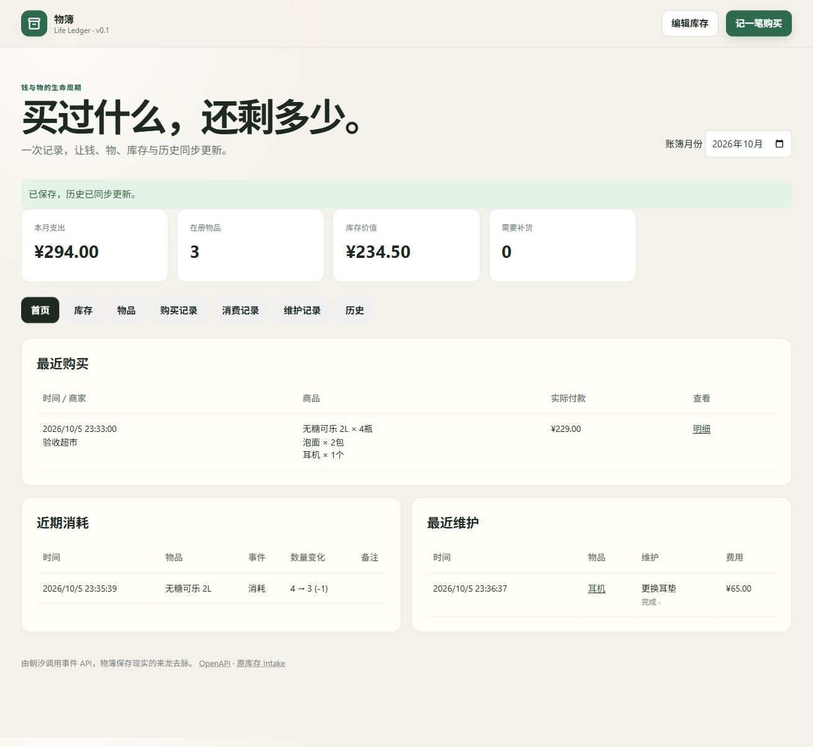

# 物簿 v0.1 验收记录

日期：2026-10-05。母体提交：`0cd0cdc110fb01deb9844948db57cd8b4900c7a1`。分支：`codex/wubu-v0.1`。

## 分阶段交付

| Phase | 调查与修改范围 | 结果 |
|---|---|---|
| 0 | 真实 SQLite / Item / adjust / Intake / OpenAPI 代码 | 审计文档先于业务修改提交 |
| 1–3 | 沿用 Store，新增 ledger DTO、schema 7、购买事务、数据库触发器 | 混合购买统一钱物，所有失败完整回滚 |
| 4 | 同一库存事件入口，用/调/开/完/弃，保留旧 adjust 返回格式 | 当前数量与 InventoryEvent 同事务，保护负库存 |
| 5 | 扩展 Item.item_type/opened_at、DurableDetails、MaintenanceEvent | 单件耐用品生命周期，维护费用与 Expense 同事务 |
| 6–7 | 查询、别名、费用汇总、REST / OpenAPI 3.1 | 查询可分页与时间筛选，关键写入支持幂等 |
| 8 | 只读审查朝汐 SDK，适配包写在物簿侧 | SDK → HTTP → SQLite 实测通过；未安装或激活到朝汐 |
| 9 | 沿用嵌入式静态 UI / 样式，新增薄账簿首页和纠错表单 | 浏览器购买、消耗、纠正与维护验证通过 |
| 10 | 核心闭环完成后评估母体能力 | 保留 AI / 媒体 / Intake 代码，仅弱化首页入口；暂不清理 |

## 自动验证

- `go test ./...`：**51 个 Go 测试通过**（含母体原测试）。
- `go vet ./...`：通过。
- `python -B -m unittest discover -s tools/wubu_tool/tests -v`，PYTHONPATH 只读包含真实朝汐 src：**8 个 Python 测试通过**。
- `node --check internal/web/static/assets/ledger.js`：通过。
- Windows 构建：`bin/wubu.exe`，版本 0.1.0；Linux CGO_ENABLED=0 交叉构建：`bin/wubu-linux`。
- OpenAPI 测试：operationId 唯一，所有引用可解析，任务书 Agent 操作完整。

## 任务书验收场景

| 场景 | 已验证结果 |
|---|---|
| A 混合购买 | ¥229 → 1 PurchaseEvent、1 Expense、3 PurchaseItem、可乐4瓶/泡面2包、耳机1件、2库存购入事件 |
| B 消耗 | 4→3，CONSUME -1，before/after/delta 正确 |
| C 纠正 | 3→5，ADJUST +2，支持绝对剩余量 |
| D 维护 | 耐用品维修 ¥65 → MaintenanceEvent + Expense，重复键不重复计费 |
| E 幂等 | 同键重放原响应，12 个并发购买请求只落一次；跨重启仍有效；不同输入 409 |
| F 回滚 | 在 Expense 已写入后用 SQL 触发器强制库存事件失败，购买/费用/物品/库存/历史/幂等均不残留 |

额外覆盖：UNTRACKED、优惠差额、最后一行失败回滚、维护费用失败回滚、并发消耗负库存保护、耐用品状态恢复、名称歧义、别名匹配与冲突、价格查询、外部订单去重、无效金额/时间/单位、旧数据迁移、旧 CRUD、Intake、自动耗尽，以及新购买不继承已过期库存。

## 浏览器与真实 SDK 验证

本地浏览器使用 `.runtime/ui-smoke.db`，与 `data/wubu.db` 分离。实际点击表单记录测试购买 ¥229，消耗一瓶至3、纠正至5，维护 ¥65，首页月支出显示 ¥294。浏览器控制台无 error / warn。

另在物簿侧使用 `python -B` 只读导入真实朝汐 SDK，构造 wubu Tool，查询可乐后发送 consume，再用相同 key 重试：SDK → 真实 HTTP → SQLite 成功，返回完全相同结果，库存只减少一次。没有启动朝汐，没有自然语言端到端对话测试。

## 交付边界与暂缓

- 朝汐 ZhaoXi 源码、配置、Git、虚拟环境、缓存和数据未写入；工具包只交付在物簿侧。实际安装/激活属于未来解除只读限制后的步骤。
- 本机未安装 Docker，所以未做容器运行验证；已保留并调整 Dockerfile / Compose，完成 Linux 交叉构建。
- 不做支付宝/微信原始账单、退款/收入、多币种换汇、LLM/OCR/向量库、预算/折旧/复式记账。导入只有统一 JSON Draft 边界，不能宣传为完整支付平台适配。
- 母体 Intake 仍是库存 Review，不能直接当作完整 PurchaseEvent；购买与费用必须从高层购买接口进入。
- 新耐用品每件一行；售出价格仅为生命周期元数据；历史引用的 Item 硬删除返回409。

正式空库可通过 `scripts/start.ps1` 启动。验收数据留在被 Git 忽略的 `.runtime`，不混入正式账簿。
